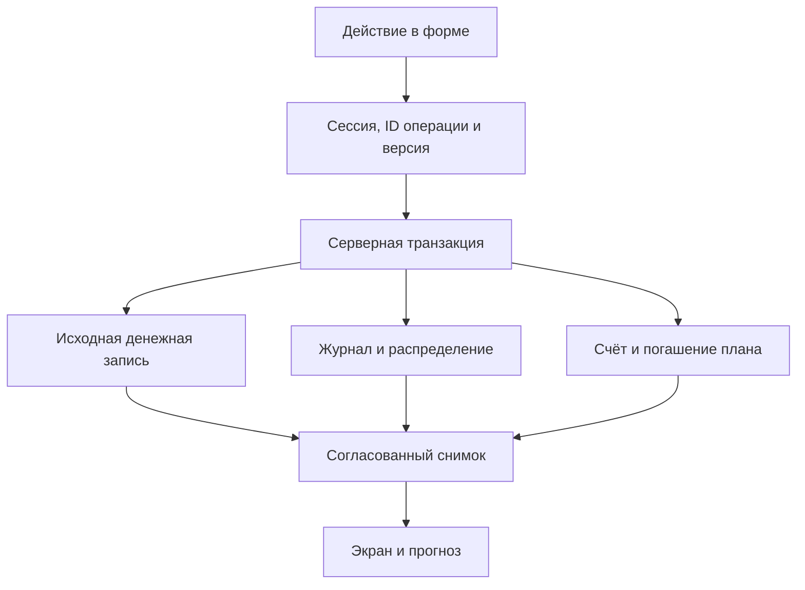

# Архитектура и сопровождение

## Организация исходников

`src/manifest.json` задаёт 35 публикуемых файлов. Большие `index.html` и `premium.js` разделены на смысловые фрагменты. Отдельные библиотеки распределены по соответствующим функциональным папкам. Построение выполняет `scripts/build.cjs`.

| Папка | Ответственность |
| --- | --- |
| `src/app` | Подключения, состояние, загрузка, события, обновления, оболочка и стили |
| `src/features/access` | Вход, проверенная сессия, доступ к разделам |
| `src/features/projects` | Список, карточка, этапы и задачи |
| `src/features/payroll` | Расчёт гонораров, начисления, табель и экспорт |
| `src/features/finance` | Журнал, календарь, резерв, кассы и проектные расчёты |
| `src/features/construction` | Объект, накладные, расчёты и операции |
| `src/features/documents` | КП, договоры, тарифы и реквизиты |
| `src/features/catalog` | Карточки, этажи, планы, OCR и импорт PDF |
| `src/features/client-portal` | Клиентская страница и серверный адаптер |
| `src/features/brief` | Клиентское ТЗ и просмотр ответов |
| `src/features/settings` | Сотрудники, должности, категории и статусы |
| `src/features/history`, `media`, `export`, `overview` | История, файлы, экспорт и сводки |

Фрагменты сохраняют общий контекст классического скрипта. Некоторые фрагменты продолжают общее замыкание, поэтому проверять синтаксис и выполнять их следует в собранном файле. Между функциями остаются глобальные зависимости через `state`, `session`, `sb` и обработчики HTML. Переход на самостоятельные ES-модули потребует отдельной проверки жизненного цикла приложения.

## Что делает сборка

1. Читает версию и цели манифеста.
2. Проверяет наличие исходников, допустимые имена выходных файлов и отсутствие повторов внутри цели.
3. Соединяет байты фрагментов без добавления разделителей.
4. Проверяет, что все исходники и публикуемые HTML, JS, CSS и `manifest.json` учтены.
5. Записывает изменившиеся результаты. В режиме `--check` сообщает о расхождении и возвращает ненулевой код.

`docs/REFACTOR_BASELINE.json` содержит SHA-256 публикуемых файлов версии `2c9fbe12`. При первоначальном выделении исходников все 35 файлов совпали с этой версией побайтно. Этот файл фиксирует исходную точку реорганизации. Будущие исправления будут менять публикуемые файлы обычным образом.

## Выполнение в браузере

Сначала загружаются Supabase и общие библиотеки, затем основной скрипт приложения. В конце HTML подключаются расширения договоров, оформления, расчётов, синхронизации, стройки, прав и финансового рабочего пространства. Порядок зафиксирован в исходниках оболочки и манифесте.

`premium.js` содержит оформление и расширения прежних экранов. `finance-workspace.js` включает актуальный финансовый экран при наличии серверного снимка версии 2. Файлы с `legacy` в имени содержат прежние расчёты или представления, которые нужны существующим обработчикам и совместимости. Перед удалением проверяйте вызовы и режим до активации нового журнала.

## Состояние и доступ

`src/app/data-loading.js` загружает данные по правам сессии. Защищённые разделы опираются на серверный `get_employee_access`. Сохранённые в браузере признаки администратора проходят повторную проверку. Истечение сессии, выход и смена учётной записи очищают закрытое состояние.

Изменения этапов сохраняются через очередь, интерфейс отображает ожидающее действие и ошибку. Обновление данных и realtime учитывают текущую форму и версию загрузки. Локальные задачи проекта в `projects/tasks.js` хранятся в `localStorage`; эту особенность следует учитывать при работе с нескольких устройств.

## Данные и денежные команды

| Слой | Реализация | Условие согласованности |
| --- | --- | --- |
| Авторизация | `arhittek_security`, серверные функции сессии и RLS | Проверенная сессия, владелец или назначенный участник |
| Исходные операции | `ledger_entries`, `company_income`, `company_expenses` | Одна фактическая операция с устойчивым ID |
| Денежный журнал | `arhittek_finance.operations` | Серверная блокировка, версия, распределение и сторно |
| Счета | `wallets`, `wallet_entries` | Сумма денег на счетах согласована с журналом |
| Планирование | `plans`, `rules`, `settlements`, `calendar_links` | Планы связаны с оплатами и остатками обязательств |
| Проекты и начисления | `projects`, `project_members`, `project_plans`, история статуса | Фактическая дата завершения и сохранённые условия |

Серверные команды и таблицы остаются в `supabase/`. `install-owner-access.sql` объединяет защиту сессий и привязку владельца. `financial-journal.sql` создаёт базовый журнал. Следующие миграции добавляют финансовое рабочее пространство, старт с нуля и фактическую дату завершения. Сценарии SQL применяются в порядке зависимостей, указанном в их документации и изолированных тестах.

После миграции нулевого старта функции `command` и `workspace_command` вызывают версии `*_before_zero_start`. Для диагностики проверяйте обе части цепочки. Одно чтение тела внешней функции покажет только обёртку.

## Изменение и выпуск

Редактируйте `src/`, затем выполняйте `npm run build` и соответствующие сценарии. CI проверяет совпадение исходников с публикуемыми файлами. При переносе старой ветки, меняющей корневой HTML или JS, перенесите её изменения в соответствующие фрагменты и пересоберите результат.

Версия кэша задаётся в `src/app/sw.js`. При изменении публикуемых ресурсов обновляйте её вместе со сборкой и проверяйте доставку на установленную PWA. Само выделение исходников сохранило прежние байты ресурсов.

Для финансовых и серверных изменений используйте отдельные проверки успешного действия, повторной отправки, потери ответа, отмены, чужой роли и устаревшей версии. В рабочей базе сверяйте установленные функции и права. Изолированная база проверяет логику на воспроизводимых примерах.
